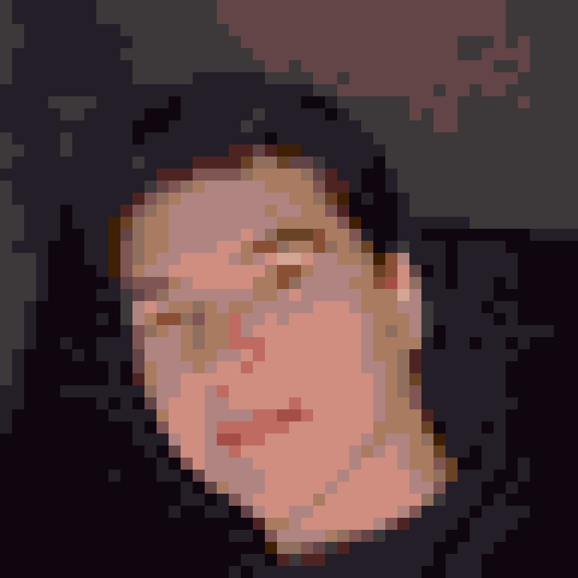

<div align="center">



<picture>
  <source media="(prefers-color-scheme: dark)" srcset="https://readme-typing-svg.demolab.com?font=JetBrains+Mono&weight=700&size=24&duration=3000&pause=800&color=39D353&center=true&vCenter=true&width=600&lines=%24+whoami;Junior+Carlini+%E2%80%94+Dev+Full-Stack+S%C3%AAnior;Django+%C2%B7+Flutter+%C2%B7+Go+%C2%B7+IoT+%C2%B7+IA+local" />
  <source media="(prefers-color-scheme: light)" srcset="https://readme-typing-svg.demolab.com?font=JetBrains+Mono&weight=700&size=24&duration=3000&pause=800&color=1A7F37&center=true&vCenter=true&width=600&lines=%24+whoami;Junior+Carlini+%E2%80%94+Dev+Full-Stack+S%C3%AAnior;Django+%C2%B7+Flutter+%C2%B7+Go+%C2%B7+IoT+%C2%B7+IA+local" />
  
</picture>

<p>
  <a href="https://juniorcarlini.github.io/"></a>
  <a href="https://www.linkedin.com/in/juniorcarlini/"></a>
  <a href="mailto:juniorcarlini@icloud.com"></a>
  <a href="http://lattes.cnpq.br/9443878372595455"></a>
</p>

</div>

```bash
➜ ~ cat sobre.md
```

Olá! Sou o **Junior**, desenvolvedor full-stack sênior formado em **Agrocomputação pelo IFRO**.
Mexo com tecnologia, design e vídeo desde os 14 anos e programo profissionalmente desde 2020.

- 🧱 **Sistemas web, mobile e corporativos** com Django, Flutter e tecnologias em tempo real
- 🐳 **Infra self-hosted**: containers, domínios, HTTPS e deploy em VPS — hoje escrevendo bastante Go
- 🤖 **IA local**: fine-tuning de LLMs, pipelines de RAG, Ollama e AnythingLLM
- 📡 **IoT e embarcados**: ESP32, Arduino, Raspberry Pi, LoRa e impressão 3D
- 🌱 **Agronegócio**: gestão rural, rastreabilidade e dados agrícolas
- 🎨 **Design, UI/UX e edição de vídeo** — do conceito à interface final

```bash
➜ ~ ls skills/
```

<div align="center">

**Linguagens & frameworks**

<picture>
  <source media="(prefers-color-scheme: dark)" srcset="https://skillicons.dev/icons?i=py,django,flask,go,rust,dart,flutter,ts,js,html,css,tailwind,bash&perline=13&theme=dark" />
  <source media="(prefers-color-scheme: light)" srcset="https://skillicons.dev/icons?i=py,django,flask,go,rust,dart,flutter,ts,js,html,css,tailwind,bash&perline=13&theme=light" />
  
</picture>

**Dados, DevOps & cloud**

<picture>
  <source media="(prefers-color-scheme: dark)" srcset="https://skillicons.dev/icons?i=postgres,redis,docker,nginx,linux,aws,cloudflare,git,github,githubactions,sentry&perline=13&theme=dark" />
  <source media="(prefers-color-scheme: light)" srcset="https://skillicons.dev/icons?i=postgres,redis,docker,nginx,linux,aws,cloudflare,git,github,githubactions,sentry&perline=13&theme=light" />
  
</picture>

**IoT, segurança & ferramentas**

<picture>
  <source media="(prefers-color-scheme: dark)" srcset="https://skillicons.dev/icons?i=arduino,raspberrypi,kali,selenium,wordpress,vscode,androidstudio,postman,figma,ps,pr,ae&perline=13&theme=dark" />
  <source media="(prefers-color-scheme: light)" srcset="https://skillicons.dev/icons?i=arduino,raspberrypi,kali,selenium,wordpress,vscode,androidstudio,postman,figma,ps,pr,ae&perline=13&theme=light" />
  
</picture>

</div>

```bash
➜ ~ ls projects/ --open-source
```

| Projeto | O que faz | Stack |
| --- | --- | --- |
| [**hangar**](https://github.com/JuniorCarlini/hangar) | Painel self-hosted para containers, com domínios de clientes e HTTPS autorizado pela aplicação | Go |
| [**minetune**](https://github.com/JuniorCarlini/minetune) | Cria e administra servidores de Minecraft (Java e Bedrock) com Docker e painel web em português | TypeScript |
| [**mesh3d**](https://pub.dev/packages/mesh3d) | Lê modelos 3D (.3mf, .glb, .obj, .stl) em Dart puro — roda no Flutter e no servidor | Dart |
| [**espia**](https://github.com/JuniorCarlini/espia) | Mostra os sinais vitais do computador e o uso de IA numa telinha ESP32 na mesa | Rust |
| [**tucano**](https://juniorcarlini.github.io/tucano/) | Componentes de formulário e interface para a web, sem dependências em runtime | HTML · Tailwind |
| [**scalego**](https://juniorcarlini.github.io/scalego/) | Monte a escala do seu time em 5 passos — sem conta, sem backend | JavaScript |
| [**disksafe**](https://github.com/JuniorCarlini/disksafe) | Detecta disco/pendrive fantasma no macOS (capacidade real menor que a anunciada) | JavaScript |

Também construí sistemas privados para bancos e consórcios ([Nexiun](https://nexiun.com.br/)), para o Ministério da Pesca (ICTIO Áudio), lojas virtuais automáticas ([ThemeShop](https://themeshop.com.br/)) e inspeção de NRs ([CheckSafe](https://checksafe.com.br/)). Detalhes no [**currículo**](https://juniorcarlini.github.io/).

```bash
➜ ~ git log --graph
```

<picture>
  <source media="(prefers-color-scheme: dark)" srcset="https://raw.githubusercontent.com/JuniorCarlini/JuniorCarlini/output/snake-dark.svg" />
  <source media="(prefers-color-scheme: light)" srcset="https://raw.githubusercontent.com/JuniorCarlini/JuniorCarlini/output/snake.svg" />
  
</picture>
